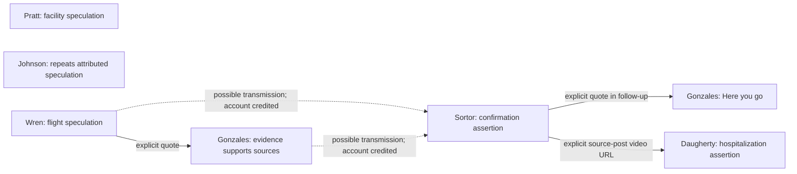

# X propagation case study with REL

This study follows a purposive sample of 24 public political accounts after discovery of
posts about a false allegation that James Talarico had received treatment at
Lindner Center of Hope. The sample prioritizes documented allegation sharing and
includes broader MAGA/pro-Trump comparison accounts. Inclusion does not establish
coordination, automation, intent, common ownership, or participation in the allegation.

## Seed sample

The [full priority list](SEEDS.md) and machine-readable `seeds.json` contain all
24 seeds, with evidence categories for nine accounts sharing allegations or
speculation, three accounts in related discussion, and twelve broader comparison
accounts. A missing amplification post in this bounded review is not proof that
an account never discussed the allegation. The original pilot evidence follows:

| Account | Observable basis for inclusion |
| --- | --- |
| [@CarolineWren](https://x.com/CarolineWren/status/2108903544426266990) | Posted flight-route speculation linking Talarico to the facility. |
| [@SaraGonzalesTX](https://x.com/SaraGonzalesTX/status/2108909919105626224) | Quoted Wren and asserted the evidence supported her sources. |
| [@nicksortor](https://x.com/nicksortor/status/2109329520247660715) | Asserted hospital confirmation, naming Wren, Gonzales, and Amacher. |
| [@RheinAmacher](https://x.com/RheinAmacher/status/2109330209195667874) | Posted the recorded-call allegation and credited earlier reporting. |
| [@mattvanswol](https://x.com/mattvanswol/status/2109330107068498007) | Repeated the allegation in a reply and called for withdrawal. |
| [@elonmusk](https://x.com/elonmusk/status/2109346652565946776) | A newly inspected reply says the campaign is hiding something big. His earlier “!!” reply remains ambiguous on its own. |

This is an episode-centered sample of public political commentators and public
figures in the right-wing/MAGA conversation, not a representative list of all
right-wing accounts. No ideological classification of otherwise private users
is inferred from search results. The first three handles configured for the
pilot are Sortor, Gonzales, and Wren. Lindner Center's account is a contextual
source and is not classified as a political seed.

## Initial episode: flight speculation becomes a confirmation claim

The claim is that Talarico's absence from campaigning was treatment at an Ohio
mental health facility rather than flu. The center directly denied that he had
ever received treatment there. This report describes public assertions; it does
not infer a person's health from absence, travel, or treatment rumors.

The following times are the displayed X times observed in the authenticated
browser. Structured HTML time attributes, where collected, supply UTC times;
reporting uses America/Los_Angeles. Relative search-result dates are not used
to order same-day posts.

| Time (Los Angeles) | Observed post | Role and evidentiary limit |
| --- | --- | --- |
| Oct 9, 2026, 6:43 AM | [Pratt](https://x.com/spencerpratt/status/2108553958696399249) | Claimed sources said Talarico was in a mental health facility, with repeated conditional qualifications. Earliest observed in the expanded collection, not an established origin. |
| Oct 9, 9:41 AM | [Johnson](https://x.com/bennyjohnson/status/2108598782610829649) | Repeated mental-hospital speculation attributed to Pratt and Musk. Account attribution does not identify an exact source post or establish a transmission edge. |
| Oct 10, 5:52 AM | [Wren](https://x.com/CarolineWren/status/2108903544426266990) | Suggested a private aircraft route and the center's proximity were suspicious. The post itself does not establish Talarico was a passenger. |
| Oct 10, 6:18 AM | [Gonzales](https://x.com/SaraGonzalesTX/status/2108909919105626224) | Explicitly quoted Wren and asserted the information supported her sources. An observable quote relationship supports a sharing edge. |
| Oct 11, 10:05 AM | [Sortor](https://x.com/nicksortor/status/2109329520247660715) | Asserted facility confirmation, credited Gonzales and Wren, and named Amacher. These are explicit account attributions; they do not identify the exact earlier posts Sortor saw. |
| Oct 11, 10:08 AM | [Amacher](https://x.com/RheinAmacher/status/2109330209195667874) | Claimed a recorded call supported a discharge and credited Wren and “@SaraGonzales.” The text's handle differs from @SaraGonzalesTX; it is preserved rather than silently corrected. Sortor's earlier timestamp does not show who originated the call material. |
| Oct 11, 10:09 AM | [Daugherty](https://x.com/EricLDaugh/status/2109330545834442967) | Asserted hospitalization, credited Sortor and Amacher, and included an explicit URL to Sortor's video. The visible post link supports an explicit sharing edge. |
| Oct 11, 10:12 AM | [Gonzales follow-up](https://x.com/SaraGonzalesTX/status/2109331268886499654) | “Here you go” with a quote of Sortor's allegation, observed in Gonzales's conversation and saved detail HTML. The HTML time attribute is 2026-10-11T17:12:18Z. |
| Oct 11, 4:47 PM | [Lindner Center](https://x.com/LindnerCtrHope/status/2109430626562785517) | Explicitly denied Talarico had ever received treatment there. |
| Oct 11, 5:44 PM | [Van Swol follow-up](https://x.com/mattvanswol/status/2109444969094414730) | Conditionally challenged the center denial by referring to alleged audio. Published about 57 minutes later and captured in the denial conversation; exact reply-parent ID remains unresolved, so no new graph edge is added. |

Additional Oct. 11 reactions were visible in Sortor's conversation:
[Van Swol](https://x.com/mattvanswol/status/2109330107068498007) repeated the
allegation, while [Musk](https://x.com/elonmusk/status/2109349314912764171) posted
“!!”, leaving stance unresolved. Their exact publication times were not
independently checked in this initial pass, so neither is positioned within
the minute-by-minute sequence. Conversation placement is recorded separately
from a confirmed reply-parent ID.

The [Poynter/PolitiFact fact-check](https://www.poynter.org/fact-checking/2026/james-talarico-psychiatric-hospital-rumor/)
reports that the full recording did not substantiate the alleged confirmation
and that public appearances contradicted the proposed timeline. The center's
[own denial](https://x.com/LindnerCtrHope/status/2109430626562785517) is the primary
source for what the center said. A Community Note on Sortor's post also links to
that denial; the note is an observed annotation, not independent proof.



Solid edges denote observed quote sharing; dashed edges denote possible
transmission with explicit account attribution but no identified source-post
reference. No edge connects Amacher and Sortor merely because their publication
times are close. Musk's ambiguous reply and Van Swol's reply placement are
omitted from the confirmed graph pending parent-reference verification.

Gonzales and Sortor each have more than one relevant appearance in the opened
conversations. That supports follow-up collection, not a ranking of influence
or a conclusion about habitual behavior. Engagement counts are later snapshots,
not the audience size when another account posted. Search ranking and reply
ordering are not chronological transmission evidence.

An alternative explanation for overlap is that accounts drew on the same flight
material and recorded call. Shared-source coverage must be separated from
direct sharing. News articles and fact-checks repeat the allegation to discuss
or dispute it; those repetitions are not counted as endorsement. The search
also surfaced [Eric Spracklen disputing the episode](https://x.com/EricSpracklen/status/2110573262954766745)
and [Richard Hanania criticizing it](https://x.com/RichardHanania/status/2111969160951710071).
They are comparison leads, not allegation amplifiers in this sample.

The Talarico episode has several observed sharing links. A second, bounded
Milan-footage comparison now has one verified external post reference, as
documented below. A third bounded campaign-video reference comparison is documented below.

## Methodology and coverage

REL owns all site browser and network activity. The collector borrows the
authenticated caller-owned `Session16781` serially and never closes it. Keep
that session free of other navigation during a cycle. The supplied session is
not silently replaced if access fails.

Each recurring cycle visits all configured timelines. Pilot and baseline also
visit date-bounded X searches for seven days of history, with at most two
PageDown actions per page. The initial episode
occurred outside that seven-day window and its explicitly configured evidence
URLs are retained as a separate historical case-study supplement. A bounded
search does not prove the historical window was exhausted. Pinned and contextual
posts may be older. Collection time and publication time are separate UTC fields.

The expanded cycle has an 80-URL queue budget and one retry per URL (at most 160
navigation attempts, including retries). Up to eight
additional detail visits address visibly truncated text. Extra searches are
limited to three configured phrases and only occur in pilot/baseline mode.
Posts outside the sample can be recorded at this one-hop discovery stage, but
their profiles and further neighbors are not traversed automatically. Redirected
external links are not fetched automatically; original, normalized and advertised
destinations are saved, and unresolved destinations remain null.

Raw rendered HTML and a UTC/hash/session sidecar accompany captures. SQLite
deduplicates post identities separately from observations and text variants.
Differences between truncated and complete text are not proof of edits. Stable
account IDs, true reply parents, hidden reposts, and unsupported quote card
structures remain null or unclassified rather than being guessed. Original
visible engagement labels are retained; abbreviated counts are not converted
into falsely precise numbers. Image-only text and spoken video content require
manual review. Ads and incidental replies are raw context, not automatically
part of the political sample or a narrative cluster.

The exact-text/shared-URL candidate export nominates items for semantic review;
it does not classify meaning or stance. Review claims expressed in different
language against the saved captures, label endorsement/dispute/quotation/mention,
and use distinctive wording rather than generic slogans. Timing patterns require
multiple cycles and comparison to ordinary event coverage. No such finding is
yet supported. The initial semantic review is recorded above.

`data/exports/coverage.jsonl` records attempts, bounded capture completion, login
barriers and exhausted retries. Absence from a later timeline never proves
deletion. Computer sleep, closed REL, session expiry, search incompleteness and
rate limits can all create gaps. No challenge bypass or proxy rotation is used.

## Run and resume

Python 3.11+ and REL on macOS are required. Install dependencies once:

```sh
cd /Users/gabe/projects.next/rel-case-studies/x-propagation
./run.sh setup
./run.sh --cycle pilot
```

This workspace's isolated environment was bootstrapped from locally installed
REL dependencies without making site requests outside REL. The requirements
file pins the public REL tool checkout for a fresh installation.

Check `config.json` for session ID and budgets. Verify the pilot's full-text
evidence captures against the visible posts before setting `pilot_verified`
to true in `data/checkpoint.json`. Then run:

```sh
./run.sh --cycle baseline
./run.sh --cycle monitor
```

Re-run the same `--cycle` after interruption. A named persistent Crawlee queue
resumes the active cycle. A new queue name per completed cycle permits account
revisits; post deduplication lives separately in SQLite. The process lock
prevents overlapping collectors. Raw captures have distinct filenames on retry.
Each execution is limited to 20 minutes, including waits for Crawlee to dispatch
work under resource pressure. At that limit the crawler is cancelled and its
cleanup awaited, existing observations are exported, and any unfinished queue
remains checkpointed for the next wakeup. This does not reset URL or retry
budgets, mark an unfinished cycle complete, or extend the study deadline.
The monitor window starts on its first run and stops collection after 14 days.
The final report still requires evidence review; it must not be labeled complete
merely because a timestamp has elapsed.

Exports: `data/exports/posts.jsonl` contains observed versions,
`observations.jsonl` contains timestamped sightings, and `coverage.jsonl` contains
visit outcomes. Raw data remains local and is ignored by Git. Curated read
captures in `captures/` document the initial source checks.

Browser captures in `captures/`, saved reference pages in `references/`, and
Crawlee runtime state in `storage/` also stay local. Committed episode records
link to public posts and identify local capture paths; reproducing those local
links requires the study workspace. The repository includes the collector,
configuration, seed evidence registry, reviewed episode summaries and tests.

Run extraction checks with `.venv/bin/python -m unittest -v test_collector`.
See `setup.json` and the verified scheduler configuration for actual monitoring
status; source code alone does not establish active monitoring.

## Verified initial run and scheduling

The successful pilot completed 14 queued visits, with 13 bounded captures and
one historical search returning no accessible posts. It retained 80 distinct
post identities and 192 observations, including incidental reply/search context.
These are collection counts, not 80 allegations or 80 seed-account posts.
`pilot-validation.json` links the three full-text verification results to raw
HTML captures. Four extraction/persistence tests passed.

The active chat heartbeat `study-public-x-narrative-propagation` was created and
its saved configuration inspected: target interval 30 minutes, current chat,
status ACTIVE. Its scope was updated to 24 accounts on October 20; the expanded
baseline is partial and checkpointed as described below. The source-verified
expansion list is in `SEEDS.md`.
The fixed UTC collection window is 2026-10-20T06:49:49Z through
2026-11-03T06:49:49Z (October 19 at 11:49 PM PDT through November 2 at 10:49 PM
PST). The daylight-saving transition changes the local wall-clock end time.
The job is instructed to stop collecting, review the final report and disable
itself after that deadline. This is a verified recurring configuration, not a
guarantee of uninterrupted execution. Keep the computer, Codex app and REL
available for local runs; see the [official scheduling documentation](https://learn.chatgpt.com/docs/automations?surface=app).

### October 20 baseline attempt

The first expanded baseline is partial, not complete. At 2026-10-20T07:31:59Z,
its queue contained 71 URLs, of which five had been handled. Captures retained
63 observations of 31 distinct posts, including incidental context. Four
30-second embedded Chromium capture timeouts affected Amacher, Van Swol, Pratt
and Loomer visits. REL's diagnostic showed connected services and a busy worker;
it did not establish a login failure. The process exited with its active queue
and checkpoint retained for the next scheduled run. The original end date and
30-minute recurring configuration remain unchanged.

`data/reviews/20261020T072011-baseline.json` contains the semantic review and
coverage audit. A possible Milan-footage wording match between an Amacher post
and a Visegrad24 quote card in a Pratt post remains a shared-source candidate.
Amacher's text is incomplete, and no direct sharing link between these seed
posts was established. No new confirmed transmission edge was added.

The collector now gives each cycle its own persistent statistics key, avoiding
request-count carryover from earlier cycles. It retains checkpoint detail keys
on resume, accepts extractable rendered posts after a selector-wait timeout,
records attempt failures, and ends an execution after three browser readiness
failures while retaining the queue. Six extraction, queue-persistence and
statistics-isolation checks passed. Original coverage events are retained;
the review separately identifies a timeout capture that nevertheless contains
posts, rather than silently rewriting its history.

At the 07:49 UTC scheduled wakeup, the same baseline resumed and completed
timeline visits for Musk, Grenell and Eagleman. It retained 49 additional
observations of 23 posts, bringing the baseline to 112 observations of 54
distinct posts including context. Capture timeouts on Meadows, Posobiec and
Catturd triggered the three-failure limit. The queue remains active with eight
handled URLs out of 74, after recovering three saved detail URLs that had not
reached the queue before earlier interruptions.

The execution review is `data/reviews/20261020T074957.json`; its runtime log is
`data/logs/wakeup-20261020T074957.log`. A complete Musk post and an incomplete
Daugherty post discuss the same SpaceX-share pledge. This remains a shared-source
candidate: routine coverage of Musk's public statement can explain the overlap,
and no canonical post-to-post reference was extracted. The Talarico graph is
unchanged. The collector now persists detail requests directly, re-submits saved
details on resume, and checks them again before marking a cycle complete.
Historical search dates are anchored to the cycle's start, so a resume after
midnight does not silently change its historical window.

At the 08:19 UTC wakeup, the baseline retained 52 additional observations of 21
posts from seven comparison-account timelines, bringing the baseline to 164
observations of 75 distinct posts including context. Four visits completed;
Libs of TikTok, John Rich and Terrence Williams yielded partial captures before
browser timeouts triggered the three-failure stop. The active queue has
12 handled URLs out of 74. The semantic review is
`data/reviews/20261020T081958.json`; no new episode or Talarico sharing edge was
established. Partial text and original failure records remain preserved.
Capture-stage diagnostics were added for future timeout records; all six
existing extraction and queue checks pass. The November 3 UTC deadline is unchanged.

At the 08:49 UTC wakeup, the resumed baseline completed the Straka and Trump Jr.
timeline visits and bounded historical searches for Wren and Amacher. It retained
103 additional observations of 46 posts, bringing the baseline to 267
observations of 109 distinct posts including context. Sortor, Gonzales and Van
Swol historical searches saved partial text before PageDown operations timed
out and triggered the three-failure stop. The queue remains active with
16 handled URLs out of 74; no baseline completion marker is set.

`data/reviews/20261020T084958.json` classifies all newly observed posts. Related
SpaceX discussion and a mailed-pamphlet allegation are candidate clusters only:
common public statements or shared material can explain overlap, and no new
canonical post-to-post transmission reference was established. The Talarico
graph and original November 3 UTC deadline remain unchanged.

At the 09:19 UTC wakeup, five further bounded historical searches completed.
The execution retained 122 observations of 48 posts, bringing the baseline to
389 observations of 136 distinct posts including context, with 21 of
74 URLs handled. Pratt, Meadows and Posobiec searches timed out during
PageDown; Loomer's handler separately reached its 150-second timeout. Partial
captures and distinct error types are preserved in the coverage export.
`data/reviews/20261020T091958.json` reviews every observed post. Similar France
wording attributed to Trump remains a common-public-statement candidate;
Grenell's repeated denials are a same-account pattern, with reply parents
unresolved. Neither adds a confirmed cross-seed edge. The baseline remains
active, and its completion marker and original stop deadline are unchanged.

At the 09:49 UTC wakeup, 4 bounded historical searches completed. The run
retained 110 observations of 43 posts, bringing the baseline to 499
observations of 162 distinct posts including context, with 25 of
74 URLs handled. Three browser timeouts retained the active baseline.
`data/reviews/20261020T094958.json` classifies all observed posts. A possible
shared disputed-video discussion remains limited by an unidentified reply
parent and unverified video identity; no new transmission edge is confirmed.

An offline quote-text audit found two posts whose quoted words had been
misattributed to a textless outer post: Wren's poll quote and Catturd's GIF
quote. The parser now scopes outer text and truncation markers outside quote
cards. All eight extraction/queue tests pass. Apply the corrections in
`data/exports/extraction-corrections.jsonl` by capture and post ID when reading
older exports; original observations and raw captures are preserved. The
full audit is `data/reviews/20261020-quote-extraction-audit.json` (13
affected observations across two post IDs). The Talarico graph, collection
budgets and original November 3 UTC deadline remain unchanged.

The Van Swol follow-up and center denial are preserved together in [this local capture](data/raw/20261020T072011-baseline/480c2d72792a35a4-0-102749246257.html). UTC attributes give 2026-10-11T23:47:07Z for the denial and 2026-10-12T00:44:06Z for the challenge. This documents a challenge after the public denial, not a source-transmission link or evidence of treatment.

### Milan footage: an observable common-source reference

[Amacher’s full post](https://x.com/RheinAmacher/status/2112438832247480391) contains a [Visegrád 24 video-post URL](https://x.com/visegrad24/status/2112247272411213987). The [saved detail capture](data/raw/20261020T072011-baseline/270da268366d9bfa-0-105323356877.html) records that explicit sharing reference. [Pratt’s post](https://x.com/spencerpratt/status/2112287046207475745) separately displays a Visegrád 24 quote describing Piazza del Duomo, preserved in [this capture](data/raw/20261020T072011-baseline/730fc444115a7eb6-0-104620504552.html). Its exact quoted post ID is unresolved.

`reviewed-milan-episode.json` records this as a common-source comparison: one canonical video-post reference to Amacher, with no Pratt–Amacher edge and no exact source-post assignment to Pratt’s quote. The source post itself was not separately opened. Shared footage or a common news description can explain the overlap; the underlying event, location and video authenticity are not independently verified. The full text resolves a prior truncation gap, not a proven edit.

### Expanded baseline completion

The baseline queue completed at **2026-10-20T11:10:51.844438+00:00**. All
74 queued URLs reached a terminal state: 61 bounded captures, 12 exhausted
retries, and one earlier no-post/inaccessible event whose recovered text is
separately audited. This is queue completion with coverage gaps, not exhaustive
historical coverage. `baseline_completed_at_utc` is preserved in the checkpoint.
The baseline retained 953 observations of 323 distinct posts including context.
The last execution added 454 observations of 239 posts, all classified in
`data/reviews/20261020T101958.json`. Three unique phrase searches were attempted
in this execution, with one permitted retry; no additional expansion search or
neighbor traversal was added.

Subsequent wakeups run monitor cycles across the 24 timelines without repeating
the historical searches. The original November 3 stop time is unchanged. The
collector now enforces that deadline for every cycle, including a resumed
baseline: it cancels and awaits an in-progress crawl at the deadline and rejects
late capture writes. Eleven extraction, queue, export and deadline checks pass. Existing
caller-owned sessions remain preserved.

The candidate export now uses the latest observation even when its own text is null, so corrected quote-only posts cannot retain older misattributed text matches. Original observations and versions remain preserved.

### Campaign video: a source-post link recovered from full text

[Daugherty’s October 20 post](https://x.com/EricLDaugh/status/2112505876292468997) contains an explicit [wcdispatch video-post URL](https://x.com/wcdispatch/status/2112388948563554668), visible in the [full detail capture](data/raw/20261020T111522-monitor/006472544a3cff89-0-132226186141.html). This establishes one source-post sharing reference. [Amacher’s earlier post](https://x.com/RheinAmacher/status/2112487984725676383) separately quotes a campaign-video allegation with Walter Curt @wcdispatch visible as the quoted author in [this capture](data/raw/20261020T111522-monitor/f89af372225205a7-0-111851299404.html). Its quoted post ID remains unresolved.

`reviewed-campaign-video-episode.json` records this limited comparison. Amacher’s and Daugherty’s posts were published at 10:15:58Z and 11:27:04Z; the interval alone does not establish transmission. No direct edge connects them, and the canonical source linked by Daugherty is not assigned to Amacher’s quote. The source post and video were not independently opened. The claimed identity, family relationship and allegations about Amy Acton remain unverified; no health or intent conclusion follows. Common public footage or ordinary campaign reporting can explain the overlap.

The first monitor cycle completed at 2026-10-20T13:37:50.402186+00:00, with all 32 URLs terminal: 25 bounded captures and 7 exhausted retries. It retained 295 observations of 121 distinct posts including incidental context. This is queue completion with coverage gaps, not exhaustive timeline coverage. `data/reviews/20261020T131459.json` records the final execution review and newly verified campaign-video reference. No historical or expansion searches ran in this monitor cycle. The baseline completion marker and original November 3 UTC deadline remain unchanged.

A later [Loomer post](https://x.com/LauraLoomer/status/2112533437714518126) endorses the campaign-video allegation and visibly quotes Walter Curt @wcdispatch in [this capture](data/raw/20261020T134513-monitor/a7dfc9eb79a25e44-0-141712417346.html). The quoted text is incomplete and its source-post ID is absent. This adds an endorsement observation, with no new explicit source-post edge or direct link among the seed posts; the underlying allegations remain unverified.

[Loomer’s later follow-up](https://x.com/LauraLoomer/status/2112577429781073981) disputes a [Polymarket odds post](https://x.com/Polymarket/status/2112561485972955405) while repeating the campaign-video allegation. The [saved capture](data/raw/20261020T154514-monitor/a7dfc9eb79a25e44-2-161553492899.html) shows the quote card and canonical source-post ID in its photo links. This supports an explicit quote-sharing edge with a **disputing** stance toward the odds, not endorsement. Loomer’s own text refers to polls; the quoted source refers to market odds. Neither measure nor the underlying campaign-video allegations are independently verified, and the source post was not separately opened.

[D’Souza also repeats the campaign-video allegation](https://x.com/DineshDSouza/status/2112584157654040691) and asserts a response by Acton, as preserved in [this capture](data/raw/20261020T154514-monitor/9b16013ded3bc734-2-164534383224.html). No canonical source-post reference appears in the captured post. This adds an endorsement observation without a new sharing edge; the video identity, claimed relationship, allegations and reported response remain unverified. Common public campaign material can explain the overlap.

[Trump Jr.’s post](https://x.com/DonaldJTrumpJr/status/2112566681210122462) urges Ohio viewers to watch a quoted campaign-video allegation. The [saved quote card](data/raw/20261020T154514-monitor/7c82d1ff8bd46c13-0-164943918782.html) visibly names Eric Daugherty, but the quoted post ID is absent. This is a named-author quotation with a promotional/critical reaction; belief in every quoted assertion is unresolved. No exact source-post assignment or new graph edge is made from matching author and wording alone.
